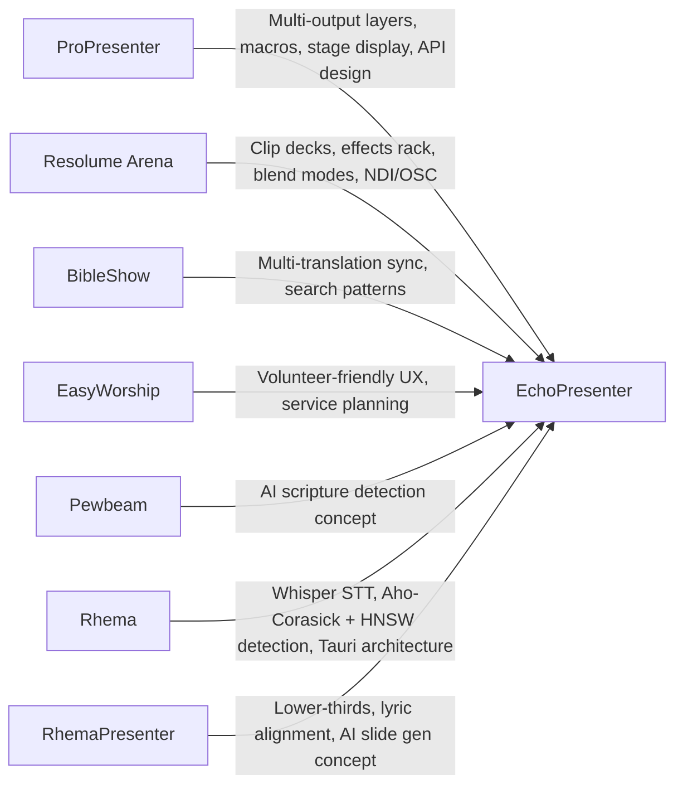

# 02 — Competitive Analysis

---

## Direct Competitors

| Product | Type | Pricing | Strengths | Weaknesses | API |
|---|---|---|---|---|---|
| **ProPresenter 7** | Church presentation | \$399 one-time | Multi-output, layers, macros, stage display, robust API | Expensive, Windows/Mac only, limited visual effects | ✅ REST + WebSocket on port 50001 |
| **EasyWorship** | Church presentation | \$299 one-time | Volunteer-friendly, good Bible support, NDI, streaming | Limited visual creativity, no AI, Windows only | ❌ Minimal |
| **Resolume Arena 7** | VJ / live visuals | \$799 one-time | Layer system, effects, projection mapping, DMX, NDI, OSC | Not designed for church, no Bible, no AI | ✅ OSC addresses |
| **BibleShow** | Bible presentation | Free / \$49 | Multi-translation sync (up to 7), search, offline | Limited presentation features, dated UI | ❌ None |
| **OpenLP** | Church presentation (OSS) | Free (GPL) | Open source, Python, cross-platform, Bible support | Dated UI, limited media, no AI, slow development | ❌ Minimal |
| **Quelea** | Church presentation (OSS) | Free (GPL) | Java, cross-platform, song database | Very dated, limited features | ❌ None |

---

## AI-Powered Competitors (Emerging)

| Product | Approach | Technology | Limitations |
|---|---|---|---|
| **Pewbeam** | AI scripture detection from live sermon | Cloud-based, subscription | Web-only, limited presentation, no visual effects |
| **Rhema** (OpenBezal) | Real-time Bible verse detection | Tauri 2 + Rust + React, local Whisper, HNSW vector search, NDI output | Scripture detection only — not a full presentation platform |
| **RhemaPresenter** | Live scripture detection + worship lyrics + AI slide generation | Electron-based, cloud STT, OpenAI slide gen, lower-thirds overlay | No native GPU rendering, limited visual effects, no Resolume-grade composition, no MCP agent control, cloud-dependent for core features |

### RhemaPresenter — Deeper Look

RhemaPresenter extends the Rhema concept into a more complete presentation tool. Key features:

- **Live scripture detection** with lower-third display during sermons
- **Worship lyric alignment** (syncs lyrics to live audio)
- **AI slide generation** from sermon notes (via OpenAI)
- **Lower-thirds overlay** for detected verses and quotes

**Where EchoPresenter differentiates:**

| Capability | RhemaPresenter | EchoPresenter |
|---|---|---|
| GPU rendering | Electron/Chromium (HTML canvas) | Native `wgpu` — pixel-perfect, hardware-accelerated |
| Visual effects | Basic overlays | Full Resolume-grade composition: layers, effects, blend modes, particles |
| Quotable Quotes | ❌ None | ✅ Real-time extraction → lower-third RGBA or full-page graphic |
| AI agent control | ❌ No MCP | ✅ Full MCP server — ChatGPT/Gemini/Claude can operate the entire app |
| Offline operation | Cloud-dependent | Local-first (Whisper, Ollama, SQLite) |
| Multi-output | Single output | Independent wgpu surfaces per output with Output Looks routing |
| Bible depth | Basic verse display | Full Bible Studio: multi-translation, FTS5, semantic search, collections |
| Document import | ❌ None | ✅ PDF, DOCX, PPTX, MD → semantic slide templates |

---

## Key Insight

> **No existing product combines all five capabilities.** ProPresenter has the best presentation engine but no AI. Resolume has the best visual engine but no Bible/church features. Pewbeam and Rhema prove AI scripture detection works. RhemaPresenter adds AI slide generation but lacks native GPU rendering, visual effects, and agent control. **EchoPresenter fills this gap with native GPU rendering, Resolume-grade visuals, real-time quotable quotes, and full MCP agent control.**

---

## What We Learn From Each

