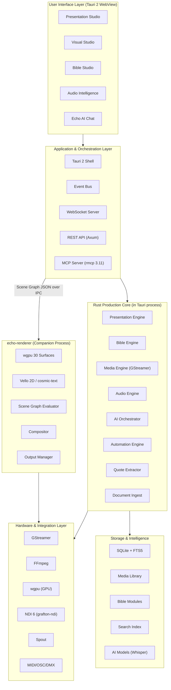

# 03 — System Architecture

---

## High-Level Architecture



---

## Key Architecture Decision: Hybrid Rendering with Companion Renderer

| Component | Renderer | Reason |
|---|---|---|
| **Operator UI** | WebView (React) via Tauri 2 | Fast development, rich UI, familiar ecosystem |
| **Audience Output** | `echo-renderer` companion process (wgpu 30) | Pixel-perfect, hardware-accelerated, survives UI reloads |
| **Preview Thumbnails** | `echo-renderer` offscreen render | Consistent with actual output |

> [!IMPORTANT]
> The audience never sees HTML. All output windows are owned by the **`echo-renderer` companion process** — a separate native executable that communicates with the main Tauri process via IPC (Unix domain socket on Linux/macOS, named pipe on Windows). This isolation means live audience outputs **survive any UI reload, frontend crash, or hot-module-replacement** during development.

### Why a Companion Process (not `winit` in-process)?

| Concern | In-process `winit` | Companion `echo-renderer` |
|---|---|---|
| Tauri event-loop conflict | ❌ `winit` and Tauri's Tao fight for the main thread | ✅ Separate event loop in its own process |
| UI crash isolation | ❌ WebView crash can tear down GPU windows | ✅ Renderer survives independently |
| Hot reload safety | ❌ Tauri `dev` restart kills GPU surfaces | ✅ Renderer stays up, reconnects to new Tauri session |
| Multi-GPU pinning | Harder to control adapter per window | ✅ Full control: pin Intel UHD 630 vs NVIDIA Quadro per output |
| Complexity | Simpler initially | More IPC plumbing, but essential for production reliability |

> [!NOTE]
> `winit` is **removed** from the dependency tree. The companion renderer creates native OS windows directly via raw Win32 (`windows-rs`) or platform equivalents, then attaches `wgpu` surfaces to them. This avoids all event-loop conflicts with Tauri 2.

---

## Scene Graph JSON (WYSIWYG Parity)

A shared **Scene Graph JSON** schema is the single source of truth for slide composition. Both the React slide editor and the `echo-renderer` GPU output consume the same schema, guaranteeing WYSIWYG parity.

```json
{
  "scene_id": "uuid-v4",
  "width": 1920,
  "height": 1080,
  "background": {
    "type": "video",
    "source": "media://motion-bg-01.mp4",
    "blend_mode": "normal",
    "opacity": 1.0
  },
  "layers": [
    {
      "id": "lyrics-layer",
      "visible": true,
      "opacity": 1.0,
      "objects": [
        {
          "type": "text",
          "content": "Amazing Grace, how sweet the sound",
          "font_family": "Inter",
          "font_size": 72,
          "font_weight": 700,
          "color": "#FFFFFF",
          "outline": { "color": "#000000", "width": 3 },
          "shadow": { "color": "#00000080", "offset": [4, 4], "blur": 8 },
          "position": { "x": 960, "y": 800 },
          "anchor": "center",
          "animation": { "type": "fade_in", "duration_ms": 500 }
        }
      ]
    },
    {
      "id": "logo-layer",
      "visible": true,
      "objects": [
        {
          "type": "image",
          "source": "media://church-logo.png",
          "position": { "x": 100, "y": 50 },
          "size": { "w": 200, "h": 80 },
          "opacity": 0.8
        }
      ]
    }
  ]
}
```

The React editor manipulates this JSON (Zustand store → serialized). Tauri IPC sends the scene to `echo-renderer`, which rasterizes it via **Vello** (2D paths + shapes) and **cosmic-text** (font shaping + layout) on top of **wgpu 30** GPU surfaces.

---

## 2D / Typography Rendering Stack

| Layer | Library | Role |
|---|---|---|
| **GPU backend** | wgpu 30 | Low-level GPU access, surface management, compute |
| **2D vector rendering** | Vello | GPU-accelerated 2D paths, shapes, gradients, effects |
| **Text shaping + layout** | cosmic-text | Unicode-correct shaping, line breaking, bidi, font fallback |
| **Compositing** | Custom compositor in `echo-renderer` | Layer blending, transitions, output routing |

> [!NOTE]
> The choice between **Vello + cosmic-text** vs **skia-safe** is pending Decision 7 (see [15_DESIGN_DECISIONS.md](15_DESIGN_DECISIONS.md)). Vello is GPU-native and Rust-first; Skia is battle-tested but requires C++ FFI and a 20 MB binary.

---

## Multi-Output Architecture with Output Looks

Each output is an independent wgpu surface managed by `echo-renderer`, with its own **Output Look** defining which layers and composition it receives:

| Output | Content | Look | Interface |
|---|---|---|---|
| Output 1 | Main LED wall / projector | Full-screen composition | GPU window |
| Output 2 | Side screens | Full-screen (may differ from Output 1) | GPU window |
| Output 3 | Confidence / stage monitor | Current + next slides, timers, notes | GPU window |
| Output 4 | Livestream lower-third | Premultiplied RGBA alpha overlay for vMix/OBS | NDI 6 output |
| Output 5 | Lobby / overflow display | Full-screen composition | GPU window |
| Output 6 | Recording feed | Full composition | File/SRT/RTMP |

A single slide click simultaneously routes **different compositions per output** via the Output Looks matrix (see [17_UI_UX_AND_LOOKS_SPEC.md](17_UI_UX_AND_LOOKS_SPEC.md)).

Each output has configurable: resolution, frame rate, layer visibility, scaling, content routing, and GPU adapter pinning.

---

## Brand Identifiers

| Item | Value |
|---|---|
| Tauri bundle ID | `com.echopresenter.app` |
| Custom URI scheme | `echopresenter://` |
| Project bundle extension | `.echopres` |
| Rust crate prefix | `echo-*` |
| Config directory | `EchoPresenter/` under OS app data |
