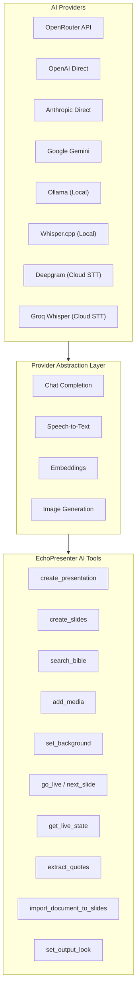

# 05 — AI Architecture

---

## AI Provider Abstraction



---

## OpenRouter Integration (Primary Cloud Gateway)

- **Base URL:** `https://openrouter.ai/api/v1`
- **Compatible:** OpenAI chat completions format
- **Models:** GPT-4o, Claude 3.5 Sonnet, Gemini Pro, Llama 3, Mistral, etc.
- **Pricing:** Per-token, model-dependent, transparent
- **Rust:** `reqwest` + `serde_json` or `openrouter_api` crate
- **Streaming:** SSE for real-time responses
- **Quote extraction:** Fast model (e.g., GPT-4o-mini, Gemini Flash) for real-time quote classification

---

## Local / Offline AI Models

| Capability | Model | Size | Hardware Requirement |
|---|---|---|---|
| **Speech-to-Text** | Whisper `base.en` | 142 MB | CPU (real-time on 4+ cores) |
| **Speech-to-Text** | Whisper `small.en` | 466 MB | GPU recommended (CUDA/Vulkan) |
| **Speech-to-Text** | Whisper `large-v3-turbo` (Q8) | ~1.6 GB | GPU required (RTX 2060+) |
| **Embeddings** | `all-MiniLM-L6-v2` | 90 MB | CPU |
| **Embeddings** | `nomic-embed-text` | 274 MB | CPU |
| **Local LLM** | Phi-3 Mini 3.8B (Q4) | ~2.3 GB | 8 GB RAM |
| **Local LLM** | Llama 3.1 8B (Q4) | ~4.7 GB | 16 GB RAM |
| **Local LLM** | Mistral 7B (Q4) | ~4.1 GB | 16 GB RAM |

> [!TIP]
> **Recommended default:** Whisper `small.en` on GPU for real-time STT with good accuracy, `all-MiniLM-L6-v2` for semantic scripture matching (CPU), Ollama for optional local LLM. Cloud via OpenRouter for high-quality content generation and quote classification.

---

## AI Safety Model

```
┌─────────────────────────────────────┐
│          AI OPERATIONS              │
├─────────────────────┬───────────────┤
│  UNRESTRICTED       │  GATED        │
│  (AI acts freely)   │  (Requires    │
│                     │   approval)   │
├─────────────────────┼───────────────┤
│ Create presentation │ Go live       │
│ Generate slides     │ Clear output  │
│ Search Bible        │ Switch output │
│ Import media        │ Blackout      │
│ Import documents    │ Delete content│
│ Edit drafts         │ Change config │
│ Build playlists     │ System actions│
│ Analyze sermon      │ Switch Look   │
│ Extract quotes      │               │
└─────────────────────┴───────────────┘
```

> [!CAUTION]
> AI can freely create and prepare content. But **live display, output switching, blackout, and destructive operations** require configurable operator approval. A church service must never depend on an AI model behaving perfectly.
