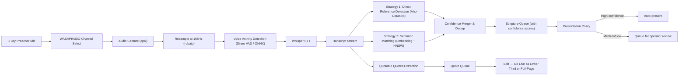

# 07 — Audio Intelligence Pipeline

---

## Real-Time Scripture Detection & Quotable Quotes



---

## Whisper STT Tiers

EchoPresenter supports three tiers of speech-to-text, selectable by the operator based on hardware and accuracy needs:

### Tier 1: Local CPU (Offline, Low Resource)

| Component | Model | Latency | Accuracy |
|---|---|---|---|
| Whisper `base.en` | 142 MB | Real-time on 4+ cores | Good for clear audio |

### Tier 2: Local GPU-Accelerated (Offline, High Quality)

| Component | Model | Latency | Accuracy |
|---|---|---|---|
| Whisper `small.en` | 466 MB | Real-time with CUDA/Vulkan | Very good |
| Whisper `large-v3-turbo` (Q8) | ~1.6 GB | Real-time with RTX 2060+ | Excellent |

GPU acceleration via `whisper-rs = "0.16"` with feature flags:
```toml
whisper-rs = { version = "0.16", features = ["cuda", "vulkan"] }
```

### Tier 3: Cloud Streaming STT (Online, Best for Difficult Audio)

| Provider | Use Case | Latency |
|---|---|---|
| **Deepgram** | Heavy accents, fast speech, reverberant rooms | ~200ms |
| **Groq Whisper** | High throughput, low cost | ~300ms |

> [!TIP]
> Cloud STT is an **opt-in toggle** in Audio Intelligence settings. Use it when local Whisper struggles with accent, pace, or room acoustics. All cloud providers use the same `SttProvider` trait so switching is seamless.

---

## Dry Preacher-Mic Aux Channel Routing

> [!IMPORTANT]
> Background keyboard pads, ambient music, and congregation noise **will confuse VAD and degrade transcription**. EchoPresenter supports direct WASAPI exclusive mode and ASIO channel selection so the operator can route the **dry preacher microphone** signal directly, bypassing the house mix.

### Audio Source Options

| Source | Method | Quality |
|---|---|---|
| Mixer aux send (dry mic) | WASAPI shared/exclusive on a USB interface input | ✅ Best — isolated voice |
| Mixer main out | WASAPI on default device | ⚠️ Acceptable — may include music |
| System audio loopback | WASAPI loopback | ❌ Poor — includes everything |
| NDI audio channel | NDI 6 audio receive | ✅ Good — if console sends isolated channel |
| ASIO device channel | ASIO driver (via `cpal` ASIO backend) | ✅ Best — per-channel selection |

The operator selects the audio device **and** specific channel(s) in the Audio Intelligence settings panel. The UI shows a live waveform per channel for verification.

---

## Three Detection Strategies

### Strategy 1: Direct Reference Detection (Aho-Corasick)

- Pre-compile all book names, abbreviations, and spoken variants
- **Feed `book_name_mapping.json`** (50+ languages) into the Aho-Corasick automaton for multilingual detection
- Handles English spoken variants: `"Romans 8:28"`, `"First Corinthians 13"`, `"one nineteen verse one oh five"`
- Handles localized names: `"Génesis"` (Spanish), `"Johannesevangelium"` (German), `"ﺗﻜﻮﻳﻦ"` (Arabic)
- Single-pass matching over streaming transcript
- **Latency:** <10ms per chunk
- **Rust crate:** `aho-corasick`

### Strategy 2: Quotation Matching (FTS5)

- When a speaker quotes scripture verbatim, match against indexed Bible text
- Use SQLite FTS5 with n-gram overlap scoring
- **Latency:** <50ms per query

### Strategy 3: Semantic Matching (Embedding + HNSW)

- For paraphrased quotes: `"nothing can separate us from God's love"` → Romans 8:38-39
- Embed transcript chunks using local ONNX model (all-MiniLM-L6-v2)
- Query pre-computed verse embeddings via HNSW index
- **Rust crates:** `ort` (ONNX Runtime), `hnsw` or `usearch`
- **Latency:** <100ms per chunk

---

## Whisper Pipeline Components

| Component | Crate | Purpose |
|---|---|---|
| Audio capture | `cpal` (with ASIO feature) | Cross-platform mic/mixer input, per-channel selection |
| Resampling | `rubato` | Convert to 16kHz mono f32 |
| VAD | `silero-vad` via `ort` | Filter silence, segment speech |
| STT (local) | `whisper-rs` 0.16 | Offline transcription (CUDA + Vulkan support) |
| STT (cloud) | `reqwest` + provider SDK | Deepgram / Groq Whisper streaming |
| GPU accel | CUDA / Vulkan via whisper.cpp | For `small.en` and `large-v3-turbo` |
