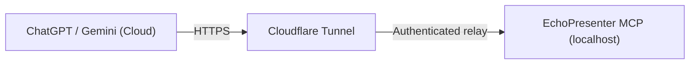

# 08 — API & MCP Specification

---

## REST API (EchoPresenter API)

```
Base URL: http://localhost:{port}/api/v1

# Presentations
POST   /presentations                      Create presentation
GET    /presentations                      List presentations
GET    /presentations/{id}                 Get presentation
PUT    /presentations/{id}                 Update presentation
DELETE /presentations/{id}                 Delete presentation

# Slides
POST   /presentations/{id}/slides          Add slides
GET    /presentations/{id}/slides          List slides
PUT    /slides/{id}                        Update slide
DELETE /slides/{id}                        Delete slide

# Document / Story-to-Slides
POST   /ingest/document                    Import document → semantic slides
POST   /ingest/story                       Generate story/narrative slides
POST   /ingest/sermon-notes                Import sermon notes → slides

# Bible
GET    /bible/translations                 List translations
GET    /bible/search?q=...                 Search scripture
GET    /bible/verse/{ref}                  Get verse (e.g., John+3:16)
GET    /bible/passage/{ref}                Get passage range
POST   /bible/detect                       Detect scripture in text

# Media
POST   /media/import                       Import media file
GET    /media                              List media library
GET    /media/{id}                         Get media item
DELETE /media/{id}                         Delete media item

# Visual Studio
GET    /visual/layers                      List visual layers
PUT    /visual/layers/{id}                 Update layer
POST   /visual/clips/trigger               Trigger a clip
PUT    /visual/effects                     Apply effect

# Live Production
GET    /show/state                         Get current live state
POST   /show/go-live                       Send content live
POST   /show/next                          Next slide
POST   /show/previous                      Previous slide
POST   /show/clear                         Clear output
POST   /show/blackout                      Blackout
PUT    /show/layers/{name}                 Control layer visibility

# Output Looks
GET    /show/looks                         List available Output Looks
GET    /show/looks/{id}                    Get Look details
PUT    /show/looks/{id}                    Update Look configuration
POST   /show/looks/{id}/activate           Activate an Output Look
PUT    /show/outputs/{id}/look             Assign Look to output

# Playlists
POST   /playlists                          Create playlist
GET    /playlists                          List playlists
PUT    /playlists/{id}                     Update playlist

# Audio Intelligence
GET    /audio/status                       Transcription status
GET    /audio/transcript                   Get current transcript
GET    /audio/detections                   Get detected scriptures
POST   /audio/start                        Start listening
POST   /audio/stop                         Stop listening

# Live Quotes
GET    /quotes                             List extracted quotes
GET    /quotes/queue                       Get pending quote queue
POST   /quotes/{id}/present-lower-third    Present quote as RGBA lower third
POST   /quotes/{id}/present-full-page      Present quote as full-page graphic
PUT    /quotes/{id}                        Edit quote text before presenting

# AI
POST   /ai/chat                            Send AI command
POST   /ai/generate/presentation           Generate presentation
POST   /ai/generate/slides                 Generate slides
GET    /ai/suggestions                     Get AI suggestions
```

---

## MCP Server (Model Context Protocol)

EchoPresenter exposes an MCP server so AI agents (Claude, ChatGPT, Gemini, etc.) can discover and use EchoPresenter tools:

```rust
// === Presentation Tools ===
#[tool(description = "Create a new presentation in EchoPresenter")]
async fn create_presentation(title: String, description: Option<String>) -> Result<Presentation>;

#[tool(description = "Add slides to a presentation")]
async fn create_slides(presentation_id: String, slides: Vec<SlideSpec>) -> Result<Vec<Slide>>;

#[tool(description = "Preview a slide before sending it live")]
async fn preview_slide(slide_id: String) -> Result<PreviewUrl>;

#[tool(description = "Send content live to the audience output (requires approval)")]
async fn go_live(content_id: String) -> Result<GoLiveResult>;

#[tool(description = "Advance to the next slide in the current presentation")]
async fn next_slide() -> Result<SlideState>;

#[tool(description = "Create a service playlist")]
async fn create_playlist(name: String, items: Vec<PlaylistItem>) -> Result<Playlist>;

// === Document / Story-to-Slides Tools ===
#[tool(description = "Import a document (PDF, DOCX, PPTX, TXT, MD) and generate semantic slides")]
async fn import_document_to_slides(file_path: String, template_style: Option<String>) -> Result<Presentation>;

#[tool(description = "Generate slides from a story or narrative text")]
async fn generate_story_slides(story_text: String, style: Option<String>) -> Result<Presentation>;

// === Bible Tools ===
#[tool(description = "Search Bible passages by reference or keyword")]
async fn search_bible(query: String, translation: Option<String>) -> Result<Vec<BibleResult>>;

#[tool(description = "Get a specific Bible verse")]
async fn get_bible_verse(reference: String, translation: Option<String>) -> Result<BibleVerse>;

// === Media Tools ===
#[tool(description = "Import media (image/video) into EchoPresenter library")]
async fn add_media(url: String, name: Option<String>) -> Result<MediaItem>;

#[tool(description = "Set the background visual on the specified output")]
async fn set_background(media_id: String, output: Option<String>) -> Result<()>;

#[tool(description = "Trigger a visual clip in the Visual Studio")]
async fn trigger_clip(clip_id: String, layer: Option<u32>) -> Result<()>;

// === Live State Tools ===
#[tool(description = "Get the current live production state")]
async fn get_live_state() -> Result<LiveState>;

// === Quote Tools ===
#[tool(description = "Extract quotable quotes from provided text")]
async fn extract_quotes(text: String) -> Result<Vec<Quote>>;

#[tool(description = "Present a quote as a premultiplied RGBA lower third")]
async fn present_quote_lower_third(quote_id: String, style: Option<String>) -> Result<()>;

#[tool(description = "Present a quote as a full-page graphic")]
async fn present_quote_full_page(quote_id: String, style: Option<String>) -> Result<()>;

// === Output Look Tools ===
#[tool(description = "Set the active Output Look (routes compositions to outputs)")]
async fn set_output_look(look_id: String) -> Result<()>;
```

**MCP Implementation:** Using `rmcp = "3.11"` with features:
- `transport-io` — stdio transport for local agents
- `transport-streamable-http-server` — HTTP transport for networked agents

---

## Remote MCP Bridge

For cloud AI agents (ChatGPT web, Gemini web) that cannot connect to `localhost`:

### Option A: Authenticated Cloudflare Tunnel (Opt-in)



- User enables "Remote AI Access" in settings
- EchoPresenter starts a `cloudflared` tunnel with API key authentication
- Cloud agents connect to `https://<user-id>.echopresenter.relay/mcp`
- All requests authenticated + rate-limited

### Option B: `.echopres` Bundle + Deep-Link Fallback

For agents that cannot maintain a persistent connection:

1. AI agent generates a presentation as a `.echopres` bundle (JSON + media assets in a ZIP)
2. Agent provides a download link or `echopresenter://import?url=...` deep-link
3. EchoPresenter registers the `echopresenter://` URI scheme at install
4. User clicks the link → EchoPresenter opens and imports the bundle

### `.echopres` Bundle Format

```
presentation.echopres (ZIP archive)
├── manifest.json        # Version, title, author, created_at
├── scenes/              # Scene Graph JSON files
│   ├── slide_001.json
│   ├── slide_002.json
│   └── ...
├── media/               # Embedded media assets
│   ├── background.mp4
│   ├── logo.png
│   └── ...
├── playlist.json        # Service order
└── bible_refs.json      # Referenced scriptures (for offline pre-fetch)
```

> [!NOTE]
> The choice between local `rmcp` only vs local + opt-in Remote Relay + `.echopres` deep-link is pending Decision 9 (see [15_DESIGN_DECISIONS.md](15_DESIGN_DECISIONS.md)).
