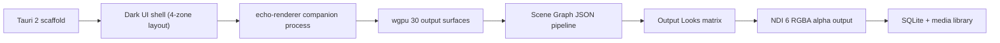

# 11 — Development Phases (Re-sequenced)

---

## Phase 1: Foundation + Output Looks + NDI (Weeks 1–6)

**Goal:** Working Tauri 2 desktop app with dark professional UI, companion `echo-renderer` process, GPU rendering, Output Looks routing, and NDI RGBA alpha output.

**Deliverables:**
- [ ] Tauri 2 project initialized with Rust workspace (`com.echopresenter.app`)
- [ ] React frontend with shadcn/ui dark theme, 4-zone operator layout
- [ ] Studio navigation (5 engine tabs) with Volunteer/Pro mode toggle
- [ ] `echo-renderer` companion process with IPC (named pipe)
- [ ] wgpu 30 rendering in output windows (Scene Graph JSON → GPU)
- [ ] Vello + cosmic-text 2D/text rendering layer
- [ ] Output Looks matrix: configure per-output layer visibility and routing
- [ ] NDI 6 output via `grafton-ndi` (premultiplied RGBA alpha for vMix/OBS)
- [ ] Basic GStreamer initialization (video file playback to texture)
- [ ] SQLite database with schema
- [ ] Basic media library (import images and videos)
- [ ] Project save/load to disk (`.echopres` bundle format)
- [ ] Keyboard shortcut framework
- [ ] `echopresenter://` URI scheme registration

**Acceptance:** App launches, opens output window on second monitor via `echo-renderer`, displays an image via wgpu, and streams premultiplied RGBA lower-third over NDI to vMix/OBS.

---

## Phase 2: Presentation Studio (Weeks 7–12)

**Goal:** Complete slide editor with text, images, animations, themes, and live presentation.

**Deliverables:**
- [ ] Slide editor canvas (multi-object: text, images, shapes via Scene Graph JSON)
- [ ] Color-coded slide grid with instant click-to-live
- [ ] Slide group system (lyrics, scripture, sermon, announcements)
- [ ] Theme system (fonts, colors, backgrounds)
- [ ] Basic animations (fade in/out, slide, scale)
- [ ] Transitions between slides (cut, fade, dissolve)
- [ ] Playlist / service schedule builder
- [ ] Live vs. preview mode toggle
- [ ] Layer system (background, content, overlay, logo) with one-click Clear buttons
- [ ] Stage display window (current/next, timer, messages) via `echo-renderer`
- [ ] PowerPoint import (.pptx parser)
- [ ] Keyboard shortcuts for all presentation actions
- [ ] Undo/redo system

**Acceptance:** User can create a multi-slide presentation, add text/images, apply a theme, build a playlist, and run a live service with preview → go-live workflow. Output Looks route different compositions per output.

---

## Phase 3: Bible Studio (Weeks 13–16)

**Goal:** Full Bible workspace with search, translations, collections, and slide generation.

**Deliverables:**
- [ ] Bible module manager (install/enable translations)
- [ ] Ship `bundled_public_domain.sqlite` (KJV, ASV, WEB, YLT, DBY)
- [ ] `user_imported.sqlite` for licensed/user translations (`.gitignore`d)
- [ ] Search by reference (book chapter:verse parsing)
- [ ] Search by keyword (FTS5)
- [ ] Multi-translation comparison view
- [ ] Verse → slide generation (auto-split, themed via semantic templates)
- [ ] Scripture collections / bookmarks
- [ ] Scripture history
- [ ] Integration with Presentation Studio (send verse to live)
- [ ] SWORD module importer

**Acceptance:** User can search `John 3:16`, view KJV/WEB side-by-side, generate a slide, and present it live.

---

## Phase 4: AI Director + Document/Story-to-Slides + MCP (Weeks 17–24)

**Goal:** AI chat, provider abstraction, content generation, document ingest, and MCP server for external agent control.

**Deliverables:**
- [ ] AI provider abstraction (trait-based)
- [ ] OpenRouter integration (primary cloud gateway)
- [ ] Direct OpenAI / Anthropic / Gemini API support
- [ ] Ollama integration (local LLM)
- [ ] AI chat panel in Bottom Dock
- [ ] Presentation generation from prompt
- [ ] Slide design/content generation
- [ ] AI-assisted Bible search (semantic)
- [ ] **Document/Story-to-Slides pipeline (`echo-ingest`):**
  - [ ] Rust parsers for PDF, DOCX, PPTX, TXT, MD
  - [ ] Visual beat chunking → semantic slide templates (`title_hero`, `scripture_split`, `quote_card`, `story_visual`, `two_column_point`)
  - [ ] Pasted sermon notes and short stories
- [ ] Voice command recognition (Whisper → command parser)
- [ ] AI automation workflows (macro builder)
- [ ] REST API server (all endpoints)
- [ ] MCP server via `rmcp 3.11` (all tools exposed)
- [ ] API authentication (key-based)
- [ ] `.echopres` bundle import via deep-link

**Acceptance:** User can type `"Create a 10-slide presentation about hope with Bible verses"` and get a complete presentation. External AI (via MCP) can create and control content. User can import a PDF sermon outline and get themed slides.

---

## Phase 5: Live Audio Intelligence — Scripture + Quotable Quotes (Weeks 25–32)

**Goal:** Live audio transcription, real-time scripture detection, quotable quotes extraction, and sermon analysis.

**Deliverables:**
- [ ] Audio device selection (WASAPI/ASIO channel routing for dry preacher mic)
- [ ] Live waveform monitoring per channel
- [ ] Real-time transcription (Whisper `small.en` on GPU, `base.en` CPU fallback)
- [ ] Optional Cloud STT toggle (Deepgram / Groq Whisper)
- [ ] Direct reference detection (Aho-Corasick with `book_name_mapping.json` for multilingual)
- [ ] Semantic scripture matching (ONNX embeddings + HNSW)
- [ ] Confidence scoring and merging
- [ ] Scripture detection queue in Bottom Dock (Audio Intelligence panel)
- [ ] Auto-present / manual-approve modes
- [ ] **Quotable Quotes engine (`echo-quotes`):**
  - [ ] Rolling 20–45s finalized transcript buffer
  - [ ] Fast OpenRouter model or local SLM for structured JSON extraction
  - [ ] Speaker attribution per service item
  - [ ] Operator approval queue with one-click present actions
  - [ ] Go Live as Lower Third (RGBA over NDI) or Full-Page Graphic
  - [ ] Dynamic text auto-fitting
- [ ] Sermon recording with timestamps
- [ ] Post-sermon intelligence report
  - [ ] Sermon summary
  - [ ] Detected scriptures list
  - [ ] Extracted quotes
  - [ ] Auto-generated slides from sermon
- [ ] Transcript export (text, SRT)

**Acceptance:** During a live sermon, EchoPresenter detects `"they that wait upon the Lord"` and surfaces Isaiah 40:31 in the scripture queue. The operator sees a powerful quote appear in the quotes queue and clicks "Go Live as Lower Third" — it appears as premultiplied RGBA alpha on the NDI output for OBS.

---

## Phase 6: Resolume Visual Studio (Weeks 33–40)

**Goal:** Resolume-inspired live visual layer with clips, effects, and hardware integration (Pro Visual Mode).

**Deliverables:**
- [ ] Clip deck UI in Bottom Dock (grid of video/image clips)
- [ ] Multiple visual layers with blend modes
- [ ] Real-time effects (blur, glow, color grade, particles)
- [ ] Effects rack (chain effects per layer)
- [ ] Opacity and transform controls per layer
- [ ] Live camera input via GStreamer
- [ ] Audio-reactive visual parameters
- [ ] NDI input (receive from external sources)
- [ ] Spout output (Windows local GPU texture sharing)
- [ ] MIDI mapping for visual controls
- [ ] OSC control interface
- [ ] Basic projection mapping (quad warp)

**Acceptance:** User can load clips, stack layers, apply effects, pipe in a camera, and output via NDI — all while Presentation Studio runs simultaneously. Visual Studio is accessible via Pro Visual Mode toggle.

---

## Phase 7: Professional Production (Weeks 41–48)

**Goal:** Broadcast-grade features, remote control, recording, and plugin system.

**Deliverables:**
- [ ] Advanced multi-output configuration
- [ ] Per-output layer visibility and routing (advanced Looks editor)
- [ ] Broadcast-quality lower thirds and titles
- [ ] Recording (local file capture)
- [ ] SRT/RTMP streaming output
- [ ] Browser-based remote control companion
- [ ] Stream Deck integration
- [ ] DMX/Art-Net lighting control
- [ ] Timecode synchronization (LTC/MTC)
- [ ] Remote MCP Bridge (Cloudflare Tunnel, opt-in)
- [ ] Plugin SDK (Rust + WASM)
- [ ] Performance profiling and optimization
- [ ] Crash recovery (auto-save, watchdog)
- [ ] Production diagnostics dashboard
