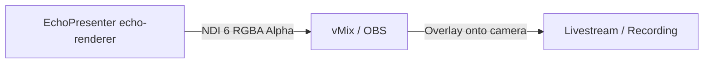

# 17 — UI/UX & Output Looks Specification

---

## Operator Layout: ProPresenter-Inspired 4-Zone Design

```
┌──────────────┬───────────────────────────────────┬──────────────────────┐
│              │                                   │                      │
│   LEFT       │          CENTER                   │      RIGHT           │
│   Libraries  │      Color-coded Slide Grid       │   Live Preview       │
│   & Service  │   (instant click-to-live)         │   Audience/Stage     │
│   Playlists  │                                   │   toggles            │
│              │                                   │   Layer Clear btns   │
│              │                                   │   Timers / Props     │
│              │                                   │                      │
├──────────────┴───────────────────────────────────┴──────────────────────┤
│                     COLLAPSIBLE BOTTOM DOCK                            │
│  [Media Bin] [Audio Intel Queue] [Clip Deck / FX] [Echo AI Chat]      │
└────────────────────────────────────────────────────────────────────────┘
```

---

## Zone Details

### Left Panel: Libraries & Service Playlists

| Element | Description |
|---|---|
| **Library Browser** | Tree view of all presentations, songs, scripture collections, media |
| **Service Playlist** | Ordered list of items for the current service (drag-and-drop reorder) |
| **Search Bar** | Instant filter across library items |
| **Quick Actions** | + New Presentation, + Add Scripture, + Import Document |
| **Collapsible** | Can be minimized to a narrow icon strip |

### Center Panel: Color-Coded Slide Grid

| Element | Description |
|---|---|
| **Slide Thumbnails** | Grid of slide previews rendered by `echo-renderer` offscreen |
| **Color Coding** | Slide groups have distinct colors: 🔵 Lyrics, 🟢 Scripture, 🟡 Sermon, 🔴 Announcements, ⚪ Custom |
| **Click-to-Live** | Single click sends the slide live to audience output immediately |
| **Active Indicator** | Currently live slide has a bright border / glow |
| **Context Menu** | Right-click: Edit, Duplicate, Delete, Move to Group, Preview |
| **Drag Reorder** | Drag slides within and between groups |

### Right Panel: Live Preview & Controls

| Element | Description |
|---|---|
| **Live Preview** | Real-time preview of what the audience sees (mirror of `echo-renderer` output) |
| **Output Toggles** | Switch preview between Audience, Stage, NDI, and each configured output |
| **Layer Clear Buttons** | One-click buttons to clear individual layers: Background, Lyrics, Scripture, Announcements, Logo, All |
| **Timers** | Countdown timer, elapsed timer, clock |
| **Props** | Quick-access props: Black, Logo, Freeze |
| **Messages** | Send text message to stage display |

### Bottom Dock: Collapsible Multi-Panel

The bottom dock switches cleanly between four panels via tab buttons:

| Tab | Panel | Contents |
|---|---|---|
| 📁 **Media Bin** | Media browser | Thumbnails of imported images, videos, motion backgrounds. Drag to slide or click to set as background |
| 🎤 **Audio Intelligence** | Live queue | Scripture detection queue (with confidence scores) + Quotable Quotes queue. One-click present actions |
| 🎬 **Clip Deck / FX** | Visual Studio controls | Resolume-style clip grid + effects rack (Pro Visual Mode only) |
| 🤖 **Echo AI** | AI chat interface | Natural language commands, AI suggestions, generation status |

> [!TIP]
> The bottom dock starts collapsed by default. The operator pulls it up when needed. Each panel remembers its last state.

---

## Volunteer Mode vs Pro Visual Mode

EchoPresenter supports two UI complexity levels, toggled in settings:

### Volunteer Mode (Default)

Designed for church volunteers with minimal training.

| Visible | Hidden |
|---|---|
| Left: Library + Playlist | Clip Deck / Effects Rack in Bottom Dock |
| Center: Slide Grid | Layer blend modes, opacity, transforms |
| Right: Preview + Clear buttons | Projection mapping |
| Bottom: Media Bin, Audio Intel, AI Chat | MIDI/OSC/DMX controls |
| Simple theme selection | Advanced theme editor |
| Basic transitions (cut, fade) | Custom shader transitions |

### Pro Visual Mode

Unlocks the full Resolume-grade visual controls for power users and production teams.

| Additionally Visible |
|---|
| Clip Deck / Effects Rack in Bottom Dock |
| Per-layer blend modes, opacity, transform controls |
| Effects chain editor |
| Audio-reactive parameter mapping |
| MIDI/OSC mapping panel |
| Advanced Output Looks editor |
| Projection mapping / quad warp |

The toggle is a single switch in the top bar: `🎬 Pro Visual Mode`. Settings persist per user profile.

---

## Output Looks Matrix

An **Output Look** defines which layers, composition, and format each output receives when a slide goes live. A single slide click simultaneously routes different compositions per output.

### Example Look: "Sunday Service"

| Output | Name | Layers Shown | Format | Resolution |
|---|---|---|---|---|
| Output 1 | Main LED | Background + Lyrics + Scripture + Logo | Full-screen opaque | 1920×1080 |
| Output 2 | Side Screens | Background + Lyrics + Scripture | Full-screen opaque | 1920×1080 |
| Output 3 | Stage Monitor | Current slide + Next slide + Timer + Notes | Confidence layout | 1920×1080 |
| Output 4 | Livestream NDI | Lyrics + Scripture + Lower-thirds only | Premultiplied RGBA alpha | 1920×1080 |
| Output 5 | Lobby TV | Announcements + Logo | Full-screen opaque | 1920×1080 |

### Example Look: "Conference Keynote"

| Output | Name | Layers Shown | Format | Resolution |
|---|---|---|---|---|
| Output 1 | Main Screen | Background + Content + Speaker Name | Full-screen opaque | 3840×2160 |
| Output 3 | Stage Monitor | Current + Next + Timer | Confidence layout | 1920×1080 |
| Output 4 | vMix NDI | Lower-third title bar only | Premultiplied RGBA alpha | 1920×1080 |

### Look Switching

- Looks can be switched via the UI (dropdown in Right Panel), REST API, or MCP tool
- Switching a Look does not interrupt the currently live slide — it re-routes the layer composition
- Each output remembers its assigned Look across app restarts

### NDI RGBA Alpha for vMix / OBS

Output 4 (or any output configured for NDI) sends **premultiplied RGBA alpha** via `grafton-ndi`. This means:

- The NDI stream has a transparent background
- vMix / OBS / Wirecast can overlay it directly onto a camera feed
- Perfect for lower-thirds (scripture, quotes, lyrics) and transparent logos
- No chroma key needed — true alpha compositing


