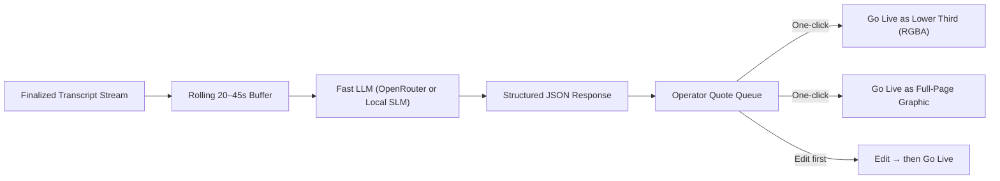
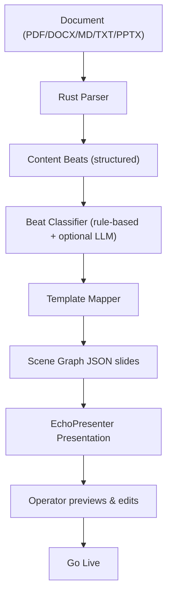

# 18 — Quote & Content Pipeline

---

## Part A: Live Quotable Quotes Engine

### Overview

During a live sermon, EchoPresenter continuously extracts powerful, shareable quotes from the preacher's words and surfaces them for instant presentation as lower-thirds or full-page graphics.

### Architecture

**Crate:** `crates/echo-quotes` (or integrated into `crates/echo-sermon-intel` if combined with scripture detection)



### Quote Extraction Pipeline

1. **Transcript Buffer:** Rolling window of 20–45 seconds of finalized (not interim) transcript text from Whisper or cloud STT
2. **LLM Classification:** Buffer sent to a fast model for structured extraction:

   **Prompt template:**
   ```
   Extract quotable quotes from this sermon transcript segment.
   Return JSON array. Only include statements that are impactful,
   memorable, or theologically significant. Skip filler and transitions.

   Transcript: "{buffer_text}"

   Speaker: "{active_speaker_name}"
   ```

   **Response schema:**
   ```json
   {
     "quotes": [
       {
         "quote_text": "God doesn't call the qualified. He qualifies the called.",
         "cleaned_grammar": "God doesn't call the qualified — He qualifies the called.",
         "category": "encouragement",
         "punchiness_score": 0.92,
         "timestamp_start": "00:14:32",
         "timestamp_end": "00:14:38"
       }
     ]
   }
   ```

3. **Speaker Attribution:** Each quote is auto-tagged with the active speaker from the current service item (e.g., "Pastor James" from the playlist's "Sermon" item)

4. **Operator Queue:** Quotes appear in the Audio Intelligence panel (Bottom Dock) with:
   - Quote text (editable)
   - Speaker name
   - Category badge
   - Punchiness score bar
   - **Action buttons:**
     - ✏️ **Edit** — modify text before presenting
     - 📺 **Go Live as Lower Third (RGBA)** — renders as premultiplied RGBA alpha overlay, sent via NDI to vMix/OBS
     - 🖼️ **Go Live as Full-Page Graphic** — renders as full-screen branded quote card on main output
     - ❌ **Dismiss** — remove from queue

### Model Selection

| Mode | Model | Latency | Use Case |
|---|---|---|---|
| Cloud (default) | GPT-4o-mini / Gemini Flash via OpenRouter | ~500ms | Best accuracy, low cost |
| Cloud (premium) | GPT-4o / Claude Sonnet via OpenRouter | ~1.5s | Highest quality |
| Local | Phi-3 Mini / Mistral 7B via Ollama | ~2s | Offline operation |

### Dynamic Text Auto-Fitting

When a quote is presented (lower-third or full-page), the text is auto-fitted to the template:

- **Lower Third:** Max 2 lines, font size scales down to fit, with speaker attribution below
- **Full-Page:** Max 4 lines centered, font size scales to fill the composition area, with decorative background from active theme

The auto-fitting algorithm:
1. Start at the template's max font size
2. Measure text bounds via cosmic-text layout
3. If text overflows, reduce font size by 2pt steps
4. If still too long after reaching min font size, truncate with ellipsis
5. Apply text animation (fade-in, typewriter, or slide-up per theme)

---

## Part B: Document & Story-to-Slides Pipeline

### Overview

**Crate:** `crates/echo-ingest`

Converts documents, sermon notes, and stories into presentation slides using **semantic slide templates** rather than asking an LLM to invent raw pixel coordinates.

### Supported Input Formats

| Format | Parser | Notes |
|---|---|---|
| **PDF** | `pdf-extract` | Extracts text, preserves heading structure |
| **DOCX** | `docx-rs` | Preserves headings, bold/italic, lists |
| **PPTX** | Custom parser (zip + XML) | Extracts slide text, notes, images |
| **TXT** | Line-based | Simple paragraph splitting |
| **MD** | `pulldown-cmark` | Respects heading levels, lists, blockquotes |
| **Pasted text** | Direct input | Sermon notes, short stories, outlines |

### Visual Beat Chunking

Instead of sending raw text to an LLM and asking for slide coordinates, EchoPresenter uses a two-stage pipeline:

#### Stage 1: Content Analysis (Rust + optional LLM)

Parse the document and classify each section into **content beats**:

| Beat Type | Trigger | Example |
|---|---|---|
| `title` | H1 heading, document title | "Walking in the Light" |
| `section_header` | H2/H3 heading | "1. What is Light?" |
| `scripture_reference` | Detected Bible reference | "John 8:12" |
| `key_point` | Bulleted/numbered list item | "Light reveals truth" |
| `quote` | Blockquote, attribution pattern | "Let your light shine — Matthew 5:16" |
| `story_beat` | Narrative paragraph | "A man walked into a dark room..." |
| `two_column` | Comparison, contrast, pros/cons | "Old vs New Covenant" |
| `conclusion` | Final section, call to action | "Go and be the light" |

#### Stage 2: Template Mapping

Each content beat maps to a **semantic slide template** (Scene Graph JSON):

| Beat Type | Template | Layout |
|---|---|---|
| `title` | `title_hero.json` | Large centered title + subtitle, full background |
| `section_header` | `section_header.json` | Bold heading + decorative divider |
| `scripture_reference` | `scripture_split.json` | Verse text left, reference right, themed background |
| `key_point` | `two_column_point.json` or `bullet_point.json` | Icon + text, or numbered point |
| `quote` | `quote_card.json` | Large quote text + attribution, decorative marks |
| `story_beat` | `story_visual.json` | Narrative text with atmospheric background |
| `two_column` | `two_column_point.json` | Side-by-side comparison layout |
| `conclusion` | `title_hero.json` variant | Call-to-action centered text |

### Template Gallery

Templates are Scene Graph JSON files in `resources/templates/`:

```json
// quote_card.json
{
  "template_id": "quote_card",
  "name": "Quote Card",
  "slots": {
    "quote_text": { "type": "text", "max_lines": 4, "auto_fit": true },
    "attribution": { "type": "text", "max_lines": 1 },
    "background": { "type": "media", "default": "gradient_dark" }
  },
  "scene": {
    "width": 1920,
    "height": 1080,
    "layers": [
      {
        "id": "bg",
        "objects": [{ "type": "slot_ref", "slot": "background" }]
      },
      {
        "id": "content",
        "objects": [
          { "type": "shape", "kind": "rect", "position": {"x": 200, "y": 200}, "size": {"w": 1520, "h": 680}, "color": "#00000060", "corner_radius": 24 },
          { "type": "text", "content": "«", "font_size": 120, "color": "#FFFFFF20", "position": {"x": 240, "y": 240} },
          { "type": "slot_ref", "slot": "quote_text", "font_size": 48, "color": "#FFFFFF", "position": {"x": 320, "y": 340}, "max_width": 1280 },
          { "type": "slot_ref", "slot": "attribution", "font_size": 28, "color": "#FFFFFF80", "position": {"x": 320, "y": 780} }
        ]
      }
    ]
  }
}
```

### Pipeline Flow



### Why Not Just Ask the LLM?

> [!NOTE]
> We deliberately avoid sending the entire document to an LLM with instructions like "create slides with these coordinates." This approach:
>
> 1. **Works offline** — the Rust parser + rule-based classifier needs no AI
> 2. **Is fast** — parsing + template mapping takes <1 second for a 20-page document
> 3. **Is consistent** — templates guarantee brand-compliant, professional layouts
> 4. **Is editable** — the operator can swap templates, re-order slides, and edit text before going live
> 5. **Optionally uses AI** — the LLM is only called for ambiguous beat classification, not layout
